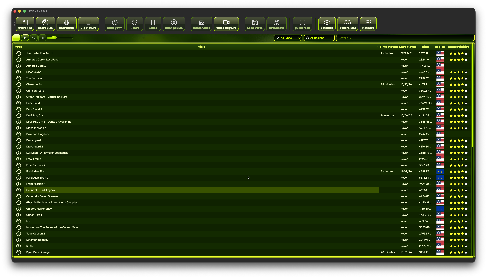

# OozAmp Gel · Neon Vat for PCSX2

The OozAmp gel look for PCSX2's desktop window (game list, toolbar, settings, menus) by Sanctum of Slime. It's a plain stylesheet with pre-rendered images, so it has no effect on emulation speed.

## Install (Mac)

1. Open PCSX2 once and quit it, so it has created its folder.
2. Double-click `install.command`. If macOS says it can't be opened, right-click it, choose **Open**, then **Open** again. Or run `bash install.command` in Terminal from this folder.
3. Open PCSX2 and go to **Settings › Interface › Theme**, then choose **custom.qss [Drop in PCSX2 Folder]**.

The installer:
- copies the images to `~/Library/Application Support/PCSX2/oozamp/`
- writes `~/Library/Application Support/PCSX2/custom.qss`, and backs up any other `custom.qss` it finds there
- installs Rubik, Rubik Wet Paint and VT323 into `~/Library/Fonts`

## Notes

- **Toolbar icons:** PCSX2 chooses white or black toolbar icons from the Mac's appearance. Use Dark Mode to get white icons, which look right on the gel.
- **Not themed:** the Mac title bar and menu bar, Big Picture mode and the game picture itself.
- **Editing:** after changing `custom.qss`, pick another theme and then pick custom.qss again to reload it.
- **Uninstall:** pick a different theme, then delete `custom.qss` and the `oozamp` folder from `~/Library/Application Support/PCSX2`.

## Credits

The fonts are under the SIL Open Font License (see `fonts/OFL-*.txt`): Rubik (Hubert & Fischer), Rubik Wet Paint (NaN), VT323 (Peter Hull).
